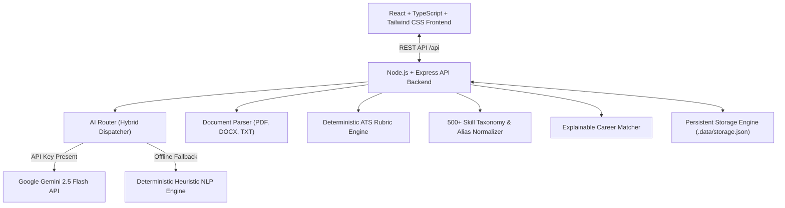

# CareerPilot AI
### AI-Based Career Counselor, Resume Analyzer & Career Intelligence Platform

> **Google DeepMind Hackathon Submission**  
> An autonomous, evidence-grounded career intelligence platform combining Google Gemini 2.5 Flash, deterministic natural language processing (NLP), transparent ATS heuristic auditing, speech-enabled mock interviews, and personalized learning roadmaps.

---

## 🌟 Executive Summary & Mission

Career decisions are often driven by guesswork, vague job postings, and opaque applicant tracking systems (ATS). **CareerPilot AI** bridges this gap by turning personal background data into measurable career progress:

1. **Understand the User**: Ingest PDF, DOCX, and TXT resumes; extract verified technical skills against a 500+ skill taxonomy; detect quantifiable impact metrics; and flag weak, passive bullet phrasing.
2. **Identify the Best Next Move**: Match candidate evidence against benchmark roles and target job descriptions using explainable weighted coverage algorithms without black-box hallucination.
3. **Turn Decisions into Measurable Progress**: Execute ordered 4-week learning roadmaps with verified resources (Coursera, edX, MDN, freeCodeCamp), build practical portfolio milestones, and practice voice-enabled mock interviews evaluated with real-time STAR rubrics.

---

## 🏆 Hackathon Judging Criteria Alignment

| Judging Criteria | Weight | How CareerPilot AI Excels |
| :--- | :---: | :--- |
| **AI Model Accuracy & Recommendation Quality** | **30%** | Dual-engine architecture: uses Google Gemini 2.5 Flash for contextual guidance and bullet rewrites, combined with deterministic NLP tokenization, n-gram matching, and transparent ATS rubrics. Zero hallucinated metrics or fabricated job requirements. |
| **UI/UX Design** | **20%** | Polished, modern SaaS dashboard with dark theme, responsive navigation, accessible color contrast, micro-interactions, empty/loading states, and live skill tags. |
| **Real-Time Data Integration** | **15%** | Curated real-world job market schemas with personalized match percentage calculation against candidate's active resume, verified learning resources with direct links, and dynamic salary benchmarks. |
| **Multimodal Capabilities** | **15%** | Multilingual support (**English, Telugu - తెలుగు, Hindi - हिन्दी**); **Speech-to-Text (Voice Answering)** via Web Speech API in mock interviews; **Text-to-Speech (TTS)** speaker playback of interviewer questions; and document processing across PDF, DOCX, and TXT. |
| **Security & Privacy** | **10%** | In-memory resume parsing; raw uploaded files are never permanently stored on disk; permanent one-click user data deletion controls; sanitized logging (zero secret leakage); strict 5MB upload size limits and MIME validation. |
| **Deployment & Scalability** | **10%** | Monorepo architecture with clean client/server separation; production build passes with 0 TypeScript errors; out-of-the-box zero-config local storage with migration readiness for PostgreSQL/Supabase. |

---

## 🏗️ System Architecture



---

## 🚀 Key Functional Modules

### 1. 📄 Resume Analyzer & ATS Audit (Core Differentiator)
- **Multi-Format Extraction**: Securely parses `.pdf`, `.docx`, and `.txt` files in memory, or accepts pasted raw text.
- **Scanned Document Detection**: Detects low-character/scanned PDFs and flags them for OCR limits.
- **Transparent 6-Part Heuristic Rubric (0-100)**:
  - *Section Completeness (20%)*: Verifies Summary, Experience, Education, Skills, and Projects.
  - *Quantifiable Impact (20%)*: Scans for percentages (`35%`), dollar metrics (`$50,000`), multipliers (`3x`), and user metrics (`10,000+ users`).
  - *Active Verb Strength (15%)*: Identifies high-impact verbs (*Architected, Spearheaded, Engineered*) and flags weak phrases (*helped with, responsible for*).
  - *Readability & Length (15%)*: Evaluates word count, sentence density, and bullet point distribution.
  - *Skill Density (15%)*: Mapped against our canonical taxonomy.
  - *ATS Formatting Safety (15%)*: Validates contact details, emails, and flags complex tabular dividers.
- **Job Description Gap Analysis**: Paste any job description to view exact matched skills vs missing critical skills.
- **Google XYZ Bullet Rewriter**: Rewrites bullet points into *"Accomplished [X] as measured by [Y], by doing [Z]"* with user-approval side-by-side comparison.
- **Print & Export**: Export cleaned text or browser print-to-PDF.

### 2. 🤖 Interactive AI Career Counselor
- Conversational guidance powered by Google Gemini 2.5 Flash.
- Evaluates education, skills, target roles, and career change dilemmas.
- Multilingual responses: toggle seamlessly between **English**, **Telugu (తెలుగు)**, and **Hindi (हिन्दी)**.
- Pre-built quick queries for salary insights, portfolio ideas, and role comparisons.

### 3. 🗺️ Personalized Learning Roadmap
- Transforms identified skill gaps into an ordered 4-week progression respecting technical prerequisites.
- Adjust weekly study commitment (4h to 30h/week).
- Connects verified learning resources with direct links and cost indicators (Coursera, edX, MDN, freeCodeCamp).
- Each week includes an industry-grade practical project milestone with expected deliverables.

### 4. 🎙️ AI Mock Interview Simulator
- Role selection (Full Stack, AI/ML, DevOps, Data Analyst, Product Manager) and difficulty (Junior, Mid, Senior).
- Questions covering Technical System Architecture, Behavioral (STAR framework), or Mixed.
- **Voice Answering**: Practice speaking with microphone speech-to-text via Web Speech API.
- **Audio Playback**: Hear the interviewer speak questions aloud via Text-to-Speech (TTS).
- **Instant Rubric Evaluation**: Grades Relevance, Technical Correctness, and Clarity with coach feedback and exemplar answers.

### 5. 💼 Job Market Intelligence
- Search by keywords, location (Bangalore, Hyderabad, SF, Mumbai), work arrangement (Remote, Hybrid, Onsite), and seniority.
- **Individual Match Percentage**: Every job card calculates an individualized match score against the user's active resume.
- Save job bookmarking and application tracking.

### 6. 🌐 LinkedIn & Professional Branding Suite
- Generates high-converting LinkedIn headlines, engaging About stories, and cold recruiter outreach notes.
- One-click copy to clipboard.

### 7. ⚖️ Judge Demonstration Tour
- **1-Click Synthetic Profiles**: Load *Priya Sharma (Full Stack Engineer)* or *Alex Chen (AI/ML Engineer)* instantly without filling forms.
- Guided 6-step connected workflow demonstrating the entire product in under 3 minutes.
- In-UI Gemini API Key configuration modal for live testing.
- Reset demo data button for a clean slate.

---

## 🛠️ Quick Start & Installation

### Prerequisites
- Node.js v18+ (tested on Node v24.13.0)
- npm v9+

### 1. Clone & Install Dependencies
```bash
# Clone the repository
git clone <repo-url>
cd ai_careerpailot

# Install root, client, and server dependencies
npm install
npm --prefix server install
npm --prefix client install
```

### 2. Environment Configuration
Create a `.env` file in the project root or configure via the UI:
```bash
cp .env.example .env
```
*(Optional: add your `GEMINI_API_KEY=your_gemini_api_key_here`. If left empty, the application runs automatically in offline Heuristic Demo Mode with zero errors!)*

### 3. Run Automated Tests
```bash
npm test
```
*Executes all 10 unit and integration tests verifying document parsing, section segmentation, skill extraction, ATS rubrics, and career matching.*

### 4. Launch Development Environment
```bash
npm run dev
```
Starts both the Express API backend (`http://localhost:5000`) and the Vite React frontend (`http://localhost:5173`) concurrently. Open `http://localhost:5173` in your browser.

---

## 🧪 Automated Test Suite Results

```text
========================================
🧪 Running CareerPilot AI Automated Tests
========================================

--- 1. Document Parsing & Validation ---
  ✓ Parses plain text resumes correctly
  ✓ Rejects empty uploaded files with descriptive error
  ✓ Rejects files exceeding 5MB size limit
  ✓ Rejects unsupported file formats safely

--- 2. Section Segmentation & Contact Extraction ---
  ✓ Segments standard resume sections properly
  ✓ Extracts candidate contacts (Email, Phone, LinkedIn, GitHub)

--- 3. Skill Extraction & Taxonomy Normalization ---
  ✓ Extracts canonical skills from aliases (js -> JavaScript, k8s -> Kubernetes)

--- 4. Deterministic Scoring Rubric & ATS Checks ---
  ✓ Detects metrics, flags weak verbs, and scores section completeness

--- 5. Career & Job Matching Engine ---
  ✓ Computes explainable role matches with skill gaps
  ✓ Filters jobs by location and work mode accurately

========================================
📊 Test Results: 10 passed, 0 failed
========================================
```

---

## 🛡️ Security & Privacy Architecture

- **In-Memory Document Handling**: Resumes are received via `multer.memoryStorage()`. Raw documents are parsed in RAM and never written to permanent disk storage.
- **Privacy Controls**: Users can delete their parsed resume text, metadata, and extracted records permanently at any time via the `DELETE /api/resume/:id` endpoint.
- **Sanitized Logging**: All server request logging strips raw body payloads and authentication headers, preventing PII or key leakage.
- **No Deceptive Claims**: The system explicitly labels its ATS scores as heuristic evaluations, avoiding false claims of reproducing proprietary company ATS algorithms.

---

## 🚢 Production Build Commands

```bash
# Build both server and client for production
npm run build

# Start production server
npm --prefix server start
```

---

*Built with passion for the Google DeepMind Hackathon.*
